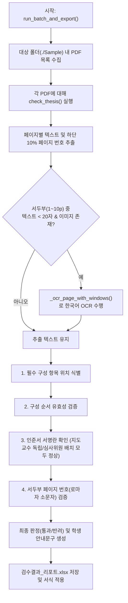

# 학위논문 체제 자동 검수 (`논문체제_검수.py`) 로직 설명

이 문서는 [논문체제_검수.py](file:///d:/작업중/☆대학원전략팀(2026년)/학위논문체제/논문체제_검수.py)의 전체 검수 흐름과 세부 판별 기준을 설명합니다.

---

## 1. 전체 처리 흐름

---

## 2. 클래스 및 주요 메서드 구조

### `ThesisValidator`
- **`__init__(target_dir="./Sample", output_excel="검수결과_리포트.xlsx")`**
  - 검수할 PDF 폴더 경로와 결과 엑셀 파일명을 초기화합니다.

---

### 2.1. 이미지 기반 페이지 OCR (`_ocr_page_with_windows`)
스캔 이미지로 삽입된 인준서 등 텍스트 추출이 불가능한 페이지를 처리합니다.

1. **PDF 페이지 이미지 렌더링**: `pymupdf`를 이용해 해당 페이지를 200 DPI의 임시 PNG 파일로 렌더링합니다.
2. **Windows 내장 OCR 호출**: PowerShell을 통해 Windows WinRT `Windows.Media.Ocr.OcrEngine`(한국어 `"ko"`)를 실행하여 텍스트와 각 단어의 바운딩 박스 좌표(`x`, `y`)를 JSON으로 추출합니다.
3. **좌표 기반 행 정렬**:
   - OCR 결과는 시각적 순서대로 반환되지 않을 수 있으므로, `y` 좌표 기준으로 정렬합니다.
   - `y` 좌표 차이가 `15px` 이내인 단어/라인을 같은 행으로 묶고, 각 행 내부는 `x` 좌표(왼쪽 → 오른쪽) 순으로 병합하여 최종 텍스트를 생성합니다.
4. **임시 파일 정리**: OCR 완료 후 생성한 임시 PNG 파일을 삭제합니다.

---

### 2.2. 개별 논문 검수 (`check_thesis`)

#### ① 페이지 텍스트 및 바닥글 추출
- `pdfplumber`로 전체 페이지를 순회하며 본문 텍스트를 추출합니다.
- **OCR 폴백 조건**: `1~10페이지(idx < 10)` 구간에서 추출된 텍스트 길이가 20자 미만이고 이미지가 포함된 경우(`len(page.images) > 0`), `_ocr_page_with_windows()`를 호출해 OCR 텍스트로 대체합니다.
- **페이지 번호 추출**: 각 페이지 하단 10% 영역(`0.90 * height ~ height`)만 크롭(crop)하여 영문자·숫자만 남기고 소문자로 정규화합니다.

#### ② 필수 구성 항목 위치 식별
공백을 제거한 텍스트(`clean_t`)에서 아래 항목이 처음 등장하는 페이지 번호를 기록합니다.

| 항목명 | 탐지 조건 |
| :--- | :--- |
| **인준서** | `"인준"` 포함 **AND** (`"심사위원"`, `"위원장"`, `"지도교수"`, `"논문으로인준"` 중 하나 이상 포함) |
| **국문초록** | `"국문초록"` 또는 `"초록"` 포함 |
| **목차** | `"목차"` 포함 |
| **본문_시작** | `"제1장"` 또는 `"I.서론"` 포함 |
| **참고문헌** | `"참고문헌"` 포함 |
| **영문초록** | 대문자 변환 텍스트에 `"ABSTRACT"` 포함 |

> [!NOTE]
> 인준서는 도장·서명 간섭으로 인해 OCR이 `"심사위원"` 일부 글자를 오인식할 수 있어(`심A 위원` 등), `"위원장"`, `"논문으로인준"` 등의 보조 키워드를 함께 확인합니다.

#### ③ 구성 순서 유효성 검증
- 기대 순서: **`인준서` → `국문초록` → `목차` → `참고문헌`**
- 항목이 검출되지 않으면 `구성순서_오류 = "항목누락"`, 이전 항목보다 앞 페이지에 위치하면 `구성순서_오류 = "순서역전"`으로 기록하고 반려 사유에 추가합니다.

#### ④ 인준서 지도교수 배치 확인
- `인준서`가 검출된 경우, 지도교수가 서명란 최하단에 독립 배치되지 않았거나 `심사위원`에 포함되어 표기되더라도 모두 `인준서_지도교수위치 = "정상"`으로 처리하여 반려하지 않습니다.

#### ⑤ 서두부 페이지 번호 체계 검증
- 검증 구간: `국문초록` 시작 페이지(미검출 시 3p)부터 `본문_시작` 직전 페이지(미검출 시 `start_p + 2`)까지.
- 하단 페이지 번호가 존재할 때 로마자 소문자 정규식(`^[ivxlcdm]+$`)에 맞지 않고 아라비아 숫자(`^\d+$`)로 표기되어 있으면 `페이지번호_오류 = "로마자누락"`으로 판정합니다.

#### ⑥ 최종 판정 및 안내문구 생성
- `상세_반려사유`가 하나라도 존재하면 `검수결과 = "반려"`로 설정하고, 학생에게 전달할 `[학위논문 체제 보완 요청]` 문구를 자동 생성합니다.
- 반려 사유가 없으면 `검수결과 = "통과"`를 유지합니다.

---

### 2.3. 일괄 실행 및 엑셀 리포트 저장 (`run_batch_and_export`)
1. `target_dir` 내 모든 `.pdf` 파일에 대해 `check_thesis()`를 실행합니다.
2. 결과를 `pandas.DataFrame`으로 모아 `검수결과_리포트.xlsx`로 저장합니다.
3. `openpyxl`로 저장된 엑셀 파일을 열어 서식을 적용합니다.
   - `B`열(`검수결과`): `"반려"`는 연한 붉은색(`#FFCCCC`), `"통과"`는 연한 녹색(`#E2EFDA`) 배경 채우기
   - `G`열(`학생_안내문구`): 줄바꿈(`wrap_text=True`) 적용

---

## 3. 실행 전 참고 사항
- **필수 라이브러리**: `pandas`, `pdfplumber`, `pymupdf`, `openpyxl`
- **운영체제 요구사항**: 이미지 OCR 기능은 Windows 내장 한국어 OCR(`Windows.Media.Ocr`)을 사용하므로 Windows 환경(한국어 언어 팩 설치 상태)에서 동작합니다.
- **엑셀 파일 잠금 주의**: `검수결과_리포트.xlsx`가 Excel에서 열려 있는 상태로 스크립트를 실행하면 `PermissionError`가 발생하므로, 실행 전 결과 엑셀 파일을 닫아야 합니다.
